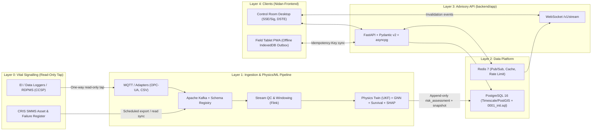

# NIDAN | निदान — Backend Architecture & Implementation Specification

**Predictive Failure Propagation Engine for Indian Railway Track Circuits**

| | |
|---|---|
| Document | Backend & Database Architecture and Implementation Specification |
| Version | 1.0 |
| Date | 24 November 2026 |
| Status | Implemented Phase 0/1/2/3 REST & WS API, PostgreSQL 16 schema, Alembic 0002, OIDC RBAC + WS auth, caching, `/metrics`, telemetry QC ingestion, and idempotent model-run publisher |
| Scope | Advisory, non-vital backend services, PostgreSQL 16 + Redis 7 data platform, streaming ingestion blueprint |
| Companion artefacts | `backend/db/0001_init.sql`, `backend/db/seed_from_fixtures.py`, `backend/app/`, `docs/Frontend-Complete-Research-Implementation.md`, `docs/AI-ML-Implementation-Spec.md`, `docs/Research/Debdatta-Complete-Research.md` |

> **Advisory, non-vital boundary.** No table, PostgreSQL role, API route, or service worker in NIDAN holds any write path or credential to Electronic Interlocking (EI), signals, routes, points, axle counters (BPAC), or track-circuit hardware. Every write endpoint is strictly workflow state (alert acknowledgement, deferral, offline field verification intake, or **draft** SMMS work-order pre-fill).

---

## Contents

1. [Executive Summary](#1-executive-summary)
2. [Architecture Overview](#2-architecture-overview)
3. [Technology Stack & Decision Record](#3-technology-stack--decision-record)
4. [Database Design & Immutability Model](#4-database-design--immutability-model)
5. [API Design & Frontend Contract](#5-api-design--frontend-contract)
6. [Authentication & Authorization (Keycloak / OIDC + RBAC)](#6-authentication--authorization-keycloak--oidc--rbac)
7. [Real-Time Architecture (`/v1/stream`)](#7-real-time-architecture-v1stream)
8. [Offline & Field Support (Idempotency & Conflict Protocol)](#8-offline--field-support-idempotency--conflict-protocol)
9. [Data Pipeline & Model Execution](#9-data-pipeline--model-execution)
10. [Security & Compliance](#10-security--compliance)
11. [Performance & Caching Strategy](#11-performance--caching-strategy)
12. [Deployment (Docker Compose & Kubernetes)](#12-deployment-docker-compose--kubernetes)
13. [Monitoring & Observability](#13-monitoring--observability)
14. [Testing Strategy](#14-testing-strategy)
15. [Implementation Roadmap](#15-implementation-roadmap)
16. [Risks & Open Questions](#16-risks--open-questions)

---

## 1. Executive Summary

NIDAN's backend converts heterogeneous Indian Railways signalling condition data (RDPMS feeds, data loggers, SMMS registers, weather cells) into calibrated, explainable, Rolling-Block-aware maintenance advisories for track circuits (`DC` and `AC`).

As verified in [Debdatta-Complete-Research.md](../docs/Research/Debdatta-Complete-Research.md) (§6, §13–14) and [Frontend-Complete-Research-Implementation.md](../docs/Frontend-Complete-Research-Implementation.md) (§12), the backend has four core responsibilities:

1. **Serve the control-room and field PWA contract** (`Nidan-Frontend/src/lib/api.ts`) over FastAPI REST (`/v1/*`) and WebSocket invalidation (`/v1/stream`) with camelCase JSON, RFC 9457 error envelopes, and pinned `modelVersions`.
2. **Guarantee auditability and policy integrity** in PostgreSQL 16 (`backend/db/0001_init.sql`): append-only `risk_assessment`, `alert_event`, and `audit_log` tables enforced by triggers, plus database-level `CHECK` constraints guaranteeing alert levels cannot contradict published policy thresholds (`critical_rule`, `warning_rule`).
3. **Support intermittent field connectivity** via idempotent observation intake (`Idempotency-Key` header + `409` conflict surfacing) matching the field PWA's IndexedDB outbox.
4. **Enforce the non-vital boundary** structurally in routes, middleware, database schema, and network topology.

### Implemented Folder Structure (`backend/`)

```text
backend/
├── .env.example                          # Local Postgres, Redis, CORS, and runtime mode template
├── Dockerfile                            # Python 3.12 slim container image for FastAPI API
├── docker-compose.yml                    # PostgreSQL 16 + Redis 7 + optional API profile
├── pyproject.toml                        # Dependencies, pytest config, ruff lint config
├── requirements.txt                      # Pip-installable runtime requirements
├── Backend-Architecture-Implementation.md
├── db/
│   ├── 0001_init.sql                     # PostgreSQL 16 schema, policy CHECKs, immutability triggers
│   ├── seed_from_fixtures.py             # Single-source-of-truth generator from frontend fixtures.ts
│   ├── seed.sql                          # Idempotent SQL seed generated from fixtures.ts
│   └── fixtures_snapshot.json            # Deterministic JSON snapshot for offline/CI test mode
├── app/
│   ├── __init__.py
│   ├── config.py                         # Pydantic Settings (DATABASE_URL, REDIS_URL, CORS, mode)
│   ├── database.py                       # asyncpg pool + redis.asyncio lifecycle + health probe
│   ├── main.py                           # FastAPI factory, lifespan, CORS, router mounting
│   ├── middleware.py                     # Trace IDs, security headers, RFC 9457, vital-path guard
│   ├── models/                           # Pydantic v2 camelCase models matching Nidan-Frontend
│   │   ├── alerts.py
│   │   ├── assets.py
│   │   ├── blocks.py
│   │   ├── clusters.py
│   │   ├── common.py
│   │   ├── field.py
│   │   ├── health.py
│   │   └── summary.py
│   ├── routes/                           # Thin REST + WebSocket endpoints under /v1/* and /healthz
│   │   ├── alerts.py
│   │   ├── assets.py
│   │   ├── auth.py
│   │   ├── blocks.py
│   │   ├── clusters.py
│   │   ├── deps.py
│   │   ├── field.py
│   │   ├── healthz.py
│   │   ├── models.py
│   │   ├── search.py
│   │   ├── summary.py
│   │   ├── work_orders.py
│   │   └── ws.py
│   └── services/                         # Repository protocol + PostgreSQL & Memory implementations
│       ├── alert_service.py
│       ├── asset_service.py
│       ├── block_service.py
│       ├── cluster_service.py
│       ├── field_service.py
│       ├── memory_repo.py
│       ├── model_service.py
│       ├── postgres_repo.py
│       ├── repository.py
│       ├── stream_hub.py
│       └── summary_service.py
└── tests/
    ├── test_api_contract.py              # End-to-end /v1/* REST + WebSocket contract suite
    ├── test_safety_invariants.py         # Non-vital boundary & SQL constraint assertions
    └── test_seed_integrity.py            # Fixture-to-seed single-source-of-truth verification
```

---

## 2. Architecture Overview

NIDAN separates **vital signalling** (Layer 0) from **advisory telemetry & analytics** (Layers 1–4) using a strict one-way ingestion boundary and isolated service layers.



### Service Boundaries

- **API Tier (`backend/app`)**: Stateless FastAPI workers serving `Nidan-Frontend` and CRIS/RDSO consumers. Never executes heavy ML inference inline on request threads; reads published `snapshot` + `risk_assessment` rows.
- **Model & Twin Engine (Batch / Stream)**: Runs on a 5–15 minute cadence (or triggered by telemetry watermark), computes physics state, GNN clusters, survival RUL (`p10`, `median`, `p90`), and SHAP attributions, and publishes an atomic `snapshot` + `risk_assessment` batch.
- **Notification & Workflow Boundary**: Creates `work_order_draft` rows (`status = 'draft'`) for engineer review. Submission to CRIS SMMS happens via explicit human review or an external approved connector—never automatically or directly into interlocking.

---

## 3. Technology Stack & Decision Record

| Layer | Chosen Technology | Justification | Rejected / Deferred Alternatives |
|---|---|---|---|
| Web Framework | **FastAPI** (Python 3.12+) | Native async I/O, OpenAPI 3.1 schema generation, typed Pydantic validation, shares Python runtime with PyTorch/NumPy/SciPy physics twin. | Django REST Framework (sync-first, heavier ORM overhead); Express/NestJS (splits language from ML/physics stack). |
| PostgreSQL Driver | **asyncpg** | Fastest native async PostgreSQL driver for Python; direct SQL control over `jsonb`, `text[]`, enum casts, and `FOR UPDATE` transactions without ORM translation bugs. | SQLAlchemy ORM (unnecessary abstraction over append-only analytical tables); psycopg2 (blocking). |
| Primary Database | **PostgreSQL 16** | Strong relational integrity (`CHECK` constraints, triggers, `jsonb`, `text[]`), TimescaleDB/PostGIS compatibility for telemetry and weather cells. | MongoDB (lacks declarative policy `CHECK` constraints and strict relational joins); MySQL (weaker `array`/`jsonb`/trigger semantics). |
| Cache & Pub/Sub | **Redis 7** | Sub-millisecond pub/sub fan-out for `/v1/stream` across API replicas, rate-limiting counters, short-TTL ETag/summary caching. | In-memory only (fails across multi-worker uvicorn/Kubernetes pods); RabbitMQ (heavier ops footprint for simple invalidations). |
| Validation & Serialization | **Pydantic v2** | Rust-backed validation (`pydantic-core`), declarative `alias_generator=to_camel` matching frontend TypeScript contracts automatically. | Manual dict serialization (error-prone camelCase drift); Marshmallow (slower). |
| Migrations | **Alembic** (next phase over `0001_init.sql`) | Versioned, reversible SQL/Python migrations once post-MVP schema evolution begins; `0001_init.sql` acts as the verified baseline. | Ad-hoc manual `psql` scripts in production. |
| Real-Time Transport | **WebSocket (`/v1/stream`)** | Bidirectional heartbeat + lightweight cache-invalidation events (`alert.upserted`, `cluster.updated`), matching `Frontend-Complete-Research-Implementation.md` §12.5. | Full-payload polling (wastes 3G field bandwidth); GraphQL subscriptions (unneeded complexity). |
| Local Infra & Lint | **Docker Compose + Ruff + Pytest** | Single-command Postgres 16 + Redis 7 spin-up with auto-seeding, fast lint (`ruff`), and contract/safety tests (`pytest`). | Local manual DB installs (drift across developer machines). |

---

## 4. Database Design & Immutability Model

The schema in [0001_init.sql](db/0001_init.sql) enforces three non-negotiable engineering rules:

### 4.1 Append-Only Assessments & Audit Trail

A supervisor reviewing an alert at 02:40 IST must see **why** a score was issued and **which model version** produced it. Mutating past predictions destroys auditability.

- **`risk_assessment`**, **`alert_event`**, **`audit_log`** have `BEFORE UPDATE OR DELETE` triggers (`nidan_reject_mutation()`) raising `restrict_violation`.
- **`field_observation`** blocks `DELETE` via `field_observation_immutable`.
- Every screen renders against a published **`snapshot`** (`as_of`, `week`, `label`) linked to a **`model_run`** (`input_watermark`, `code_version`, `params`) and **`model_registry`**.

### 4.2 Policy Rules Enforced in SQL

Levels cannot contradict the published alerting policy even if a buggy pipeline attempts to insert an inconsistent row:

- `critical_rule`: `level <> 'critical' or h24 > 0.5 or cluster_root`
- `warning_rule`: `level <> 'warning' or h72 > 0.3`
- `block_pairing`: `(block_window_id is null) = (block_fit is null)`
- `deferral_complete`: `(status <> 'deferred') or (deferral_reason is not null and deferral_review_date is not null)`
- `smms_only_when_submitted`: `(smms_reference is null) or (status <> 'draft')`

### 4.3 Provenance Separation & Derived Cluster Membership

- `asset_record_source` stores `provenance` and `fetched_at` beside `asset` so operators can distinguish SMMS asset register metadata from live logger telemetry.
- Cluster membership (`Cluster.members` and `Cluster.alertsFolded`) is derived dynamically via `alert.cluster_id`, guaranteeing the cluster panel, alert queue, and asset page can never disagree.

### 4.4 Single-Source-of-Truth Seed Pipeline

`backend/db/seed_from_fixtures.py` evaluates `Nidan-Frontend/src/data/fixtures.ts` via Bun (`1.4.4+`), producing both:
- `backend/db/seed.sql` (idempotent `INSERT ... ON CONFLICT` script loaded automatically after `0001_init.sql` in Docker)
- `backend/db/fixtures_snapshot.json` (used by `MemoryRepository` in offline dev and CI contract tests)

---

## 5. API Design & Frontend Contract

All endpoints follow [Nidan-Frontend/src/lib/api.ts](../Nidan-Frontend/src/lib/api.ts) and [Frontend-Complete-Research-Implementation.md](../docs/Frontend-Complete-Research-Implementation.md) §12:

### 5.1 Conventions

- **URL Prefix**: `/v1` (additive changes only within `/v1`; `/healthz` for container probes).
- **Serialization**: `camelCase` JSON (`CamelModel` with `alias_generator=to_camel`).
- **Timestamps**: ISO 8601 UTC with `Z` (`generatedAt`), rendered as IST in the UI.
- **Audit Headers**: Every queue/collection response sets `X-NIDAN-Generated-At`, `X-NIDAN-Model-Versions`, `X-NIDAN-Mode: advisory-non-vital`, and `X-Trace-Id`.
- **Slash-Delimited Asset IDs**: Asset IDs such as `ADRA/TC/12T` work seamlessly whether URL-encoded (`ADRA%2FTC%2F12T`) or path-delimited via `{asset_id:path}`.
- **RFC 9457 Errors**: All 4xx/5xx responses return `application/problem+json` with `type`, `title`, `status`, `detail`, `traceId`, and `retryable`—never raw stack traces or SQL errors.

### 5.2 Endpoint Inventory

| Method | Path | Purpose | Cache-Control |
|---|---|---|---|
| `GET` | `/healthz` | Liveness, Postgres/Redis status, advisory flag | `no-store` |
| `GET` | `/v1/alerts` | Ranked alert queue (`Alert[]` ordered by `policyRank`) | `private, max-age=15` |
| `GET` | `/v1/alerts/{id}` | Single alert with three-lens explanation | `private, max-age=30` |
| `POST` | `/v1/alerts/{id}/acknowledge` | Append `acknowledged` event + audit log | `no-store` |
| `POST` | `/v1/alerts/{id}/defer` | Defer with `reason` (>=10 chars) + `reviewDate` | `no-store` |
| `GET` | `/v1/assets/{assetId}` | Asset record, 12-day `SignalSeries[]`, `ModeRow[]`, active alert | `private, max-age=60` |
| `GET` | `/v1/assets/{assetId}/explanation` | Three-lens explanation (`Physics` / `Model` / `Precedents`) | `private, max-age=30` |
| `GET` | `/v1/blocks` | Published Rolling Block windows + fitted `BlockJob[]` | `private, max-age=300` |
| `GET` | `/v1/clusters` | Common-cause clusters with derived `members` | `private, max-age=30` |
| `POST` | `/v1/clusters/{id}/merge` | Fold alert IDs into a cluster | `no-store` |
| `GET` | `/v1/field/tasks` | Bilingual (`en`/`hi`) field verification tasks + sync status | `private, max-age=30` |
| `POST` | `/v1/field/observations` | Idempotent field intake (`Idempotency-Key`, 409 on conflict) | `no-store` |
| `GET` | `/v1/models/health` | Calibration bins, ECE, conformal coverage, drift PSI, gates | `private, max-age=300` |
| `GET` | `/v1/summary` | Command center KPIs and queue severity breakdown | `private, max-age=15` |
| `POST` | `/v1/work-orders/draft` | Create local SMMS draft (`status: "draft"` only) | `no-store` |
| `GET` | `/v1/search?q=` | Federated search (alerts, assets, clusters, SMMS precedents) | `no-store` |
| `GET` | `/v1/me` | Operator role, division scope, advisory capability flags | `private, max-age=600` |
| `POST` | `/v1/ingest/telemetry` | Canonical, C-DOT CCSP, and RDSO RDPMS telemetry intake with Stream QC (`service` role) | `no-store` |
| `POST` | `/v1/ingest/model-run` | Idempotent, fail-closed `model_run` + `snapshot` + `cluster` + `risk_assessment` publish (`service` role) | `no-store` |
| `GET` | `/metrics` | Prometheus exposition metrics (latency, WS connections, DB pool, field sync) | `no-store` |
| `WS` | `/v1/stream` | Cache-invalidation events + 15 s heartbeat | — |

---

## 6. Authentication & Authorization (Keycloak / OIDC + RBAC)

Production deployment delegates identity to **Keycloak** (OIDC / OAuth 2.1 with PKCE for web/PWA and client-credentials mTLS for ingestion services), mapped onto the `user_role` enum in `0001_init.sql`:

| Role (`user_role`) | Railway Persona | Division Scope | Allowed Actions |
|---|---|---|---|
| `maintainer` | ESM / Track Maintainer | Assigned section/division | Read `field/tasks`, submit `field/observations` |
| `operator` | SSE (Sig) / Divisional Control | Assigned division (`ADRA`, `KGP`, etc.) | Read all views, acknowledge/defer alerts, merge clusters, create `work_order_draft` |
| `dste` | Sr. DSTE / Divisional Leadership | Division or Zone | All `operator` actions + Rolling Block planning & model review sign-off |
| `service` | CRIS / RDPMS / Model Runner | System-wide (ingest only) | Append telemetry, publish `snapshot` + `risk_assessment` (no workflow mutation) |
| `admin` | Platform Administrator | System-wide | Model registry promotion gates, audit inspection (still **no** vital write path) |

**Phase 2 State**: `AUTH_MODE=dev` (default) preserves the seeded `operator` persona (`ADRA`, `BKSC`, `KGP`, `TATA` demo scope) for local development and fixture tests. Setting `AUTH_MODE=oidc` enforces RS256/ES256 JWKS JWT verification (`iss`, `aud`, `exp`, `realm_access.roles`, `division_ids`/`groups`), role checks (`maintainer`, `operator`, `dste`, `service`, `admin`), and division-level scoping across `/v1/*` routes via `backend/app/auth.py`.

---

## 7. Real-Time Architecture (`/v1/stream`)

To avoid stale or client-assembled state, `/v1/stream` carries **cache-invalidation events only**, matching `StreamEvent` in `Frontend-Complete-Research-Implementation.md` §12.5:

```json
{"type": "alert.upserted", "alertId": "alr-7f3c", "level": "watch", "assetId": "ADRA/TC/12T", "snapshotId": "snap-2026-07-14T00:20Z"}
{"type": "alert.closed", "alertId": "alr-7f3c", "outcome": "deferred"}
{"type": "cluster.updated", "clusterId": "c-9917"}
{"type": "block.published", "window": {"id": "RB-28", ...}}
{"type": "model.promoted", "model": "Physics twin", "version": "0.3.1"}
{"type": "heartbeat", "at": "2026-07-14T00:20:00Z"}
```

- **Multi-replica fan-out**: `StreamHub` publishes events to Redis channel `nidan:stream:events` when Redis is connected, and broadcasts locally across open WebSocket connections in-process when Redis is absent.
- **Heartbeat**: Server sends `{"type": "heartbeat", "at": "...Z"}` every 15 seconds if no client frame arrives, enabling clients to detect half-open 3G/4G connections and fall back cleanly to 30-second polling.

---

## 8. Offline & Field Support (Idempotency & Conflict Protocol)

Track maintainers operate in yards and mid-section culverts with intermittent cellular coverage. The field PWA (`Nidan-Frontend/src/lib/outbox.ts`) queues mutations in IndexedDB and drains them sequentially on reconnect:

1. **Idempotency-Key Enforcement**: `POST /v1/field/observations` requires an `Idempotency-Key` header (UUID v7 / `body.idempotencyKey`).
2. **Unique DB Constraint**: `field_observation.idempotency_key` has a `UNIQUE` index in PostgreSQL.
3. **Replay vs Conflict**:
   - Identical replay (same key, same `taskId`, `finding`, `measurements`, `note`) returns HTTP `200` with the original receipt and `replayed: true`.
   - Divergent replay (same key, different payload) returns HTTP `409` (`urn:nidan:idempotency-conflict`) carrying both `serverRecord` and `localRecord` so the technician UI presents an explicit merge dialog without silently overwriting field measurements.

---

## 9. Data Pipeline & Model Execution

1. **Edge & Vendor Ingestion**: Galvanically isolated voltage/current taps + existing OEM RDPMS / data loggers emit telemetry over **MQTT (TLS + client certs)** or **C-DOT CCSP / oneM2M** adapters into **Apache Kafka** (canonical Avro/Protobuf schema).
2. **Stream QC (`quality` codes)**: Flink computes 10 s / 1 min aggregates, tags gaps or stuck logger readings (`0 = measured`, `1 = interpolated`, `2 = suspect`), and writes to `telemetry_reading`.
3. **Physics + ML Scoring Cadence**:
   - **Physics Twin (UKF)**: Estimates hidden ballast conductance $G_b$ and rail-bond resistance from terminal voltage/current ratios.
   - **Mode Classifier + TreeSHAP**: Classifies F1–F12 and extracts top signed SHAP drivers.
   - **Heterogeneous GNN**: Groups correlated alerts sharing `weather_cell`, `relay_room`, `cable_id`, or `supply_id` into `cluster` records and predicts cascade windows.
   - **Conformal Survival Model**: Outputs calibrated `p10_days`, `median_days`, `p90_days` with empirical coverage tracking (`0.897` over `3,180` held-out outcomes).
4. **Atomic Snapshot Publication**: A `model_run` writes new `risk_assessment` rows for a `snapshot`, advances `alert.current_assessment_id`, and emits `alert.upserted` to Redis.

---

## 10. Security & Compliance

- **No Vital Write Path**: Enforced at four layers—(1) physically one-way L0→L1 tap/diode, (2) zero vital-control endpoints in FastAPI (`test_safety_invariants.py`), (3) middleware 403 guard (`VITAL_CONTROL_PATTERNS`), and (4) Postgres roles restricted to `nidan` schema.
- **Security Headers**: Every response emits `X-Content-Type-Options: nosniff`, `X-Frame-Options: DENY`, `Referrer-Policy: strict-origin-when-cross-origin`, `Content-Security-Policy`, `X-NIDAN-Mode: advisory-non-vital`, and `X-Trace-Id`.
- **CCSP & RDSO Alignment**: Designed for **RDSO/SPN/257/2025 v2.0** (RDPMS) and **C-DOT CCSP** canonical ingestion adapters.
- **PII Minimization**: Only operational asset IDs, division codes, and role-scoped `app_user.display_name` values are stored; no passenger data, no personal mobile numbers or GPS tracking of staff.
- **Secrets Management**: `.env` is gitignored; production injects database/OIDC/mTLS credentials from HashiCorp Vault or Kubernetes sealed secrets.

---

## 11. Performance & Caching Strategy

- **Connection Pooling**: `asyncpg.create_pool(min_size=2, max_size=10, command_timeout=15.0)` per worker process.
- **Indexed Hot Paths**: `telemetry_recent_idx (asset_id, signal_key, observed_at desc)`, `assessment_asset_idx (asset_id, computed_at desc)`, `alert_status_idx (status, opened_at desc)`, and `audit_entity_idx`.
- **Two-Stage Alert Payload**: `GET /v1/alerts` is cacheable (`max-age=15`), and `GET /v1/models/health` / `GET /v1/blocks` carry `max-age=300` so 3G field tablets avoid redundant heavy transfers.
- **Query Budget**: Single-digit millisecond queries for 11–500 active alerts per division; Redis response caching and cursor pagination scale `GET /v1/alerts` cleanly to zonal workloads (>5,000 track circuits).

---

## 12. Deployment (Docker Compose & Kubernetes)

### Local Development (`backend/docker-compose.yml`)

```bash
cd backend
cp .env.example .env
docker compose up -d postgres redis
# Postgres automatically executes db/0001_init.sql then db/seed.sql on first boot
uvicorn app.main:app --reload --port 8000
```

Or run the entire stack (Postgres + Redis + FastAPI container) via:

```bash
docker compose --profile full up --build
```

### Production (Kubernetes)

- **API Deployment**: 2+ FastAPI pods (`uvicorn` / `gunicorn -k uvicorn.workers.UvicornWorker`), readiness/liveness probes on `GET /healthz`, HPA scaling on CPU/request latency.
- **Data Tier**: Managed/HA PostgreSQL 16 (with TimescaleDB extension for `telemetry_reading` hypertables) + Redis Sentinel/Cluster.
- **CI/CD (`.github/workflows/ci.yml`)**: Runs `ruff check .` and `pytest` on every PR targeting `main`.

---

## 13. Monitoring & Observability

- **Structured Logging + Trace Correlation**: Every request attaches `X-Trace-Id` (or incoming W3C `traceparent`) and includes `traceId` in RFC 9457 error responses.
- **Service Metrics (Prometheus / OpenTelemetry)**: Track request latency (`p50`/`p95`/`p99` per route), PostgreSQL pool utilization, WebSocket active connections, and `field_observation` idempotency replay/conflict rates.
- **Model Assurance (`/v1/models/health`)**: Surfaces ECE (`<= 0.05`), conformal coverage (`0.88–0.92`), subgroup division parity (`<= 0.04`), PSI feature drift (`threshold 0.20`), and shadow-period gates (`>= 28 days`) directly to DSTE reviewers.

---

## 14. Testing Strategy

1. **API Contract Tests (`tests/test_api_contract.py`)**: Exercises all `/v1/*` REST routes and `/v1/stream` WebSocket against the fixture-backed store, validating camelCase keys, RFC 9457 errors, deferral rules, cluster merging, and idempotency replay/409 conflicts.
2. **Safety Invariant Tests (`tests/test_safety_invariants.py`)**: Scans registered FastAPI routes to verify zero vital command endpoints exist, asserts `/v1/interlocking/.../command` returns `403 urn:nidan:advisory-only`, and verifies `0001_init.sql` retains all immutability triggers and policy `CHECK` constraints.
3. **Seed Integrity Tests (`tests/test_seed_integrity.py`)**: Verifies `seed.sql` and `fixtures_snapshot.json` remain synchronized with all 11 alerts, 11 assets, 7 blocks, 8 jobs, 2 clusters, and 3 field tasks, and that field task `lastReadings` match telemetry endpoints.
4. **Live DB Integration Tests (Phase 2 CI service container)**: Run `0001_init.sql` + `seed.sql` inside a `postgres:16-alpine` service container and execute `PostgresRepository` against live SQL triggers and constraints.

---

## 15. Implementation Roadmap

| Phase | Scope | Deliverables |
|---|---|---|
| **Phase 0–1 (Completed)** | Schema, fixture seed pipeline, core REST + WebSocket API | `0001_init.sql`, `seed_from_fixtures.py`, `seed.sql`, `docker-compose.yml`, FastAPI `/v1/*` + `/v1/stream`, `pytest` & `ruff` CI gates |
| **Phase 2 (Completed)** | Live Postgres CI, OIDC/Keycloak RBAC, Alembic, caching, `/metrics`, ingest endpoint | `alembic/` (`0001` baseline), `app/auth.py` (JWKS JWT + division RBAC), `app/cache.py` (ETag + Redis TTL), `StreamHub` Redis subscriber loop, `POST /v1/ingest/model-run`, `GET /metrics`, `backend-integration-ci` Postgres 16 + Redis 7 job |
| **Phase 3 (Completed)** | Telemetry ingestion, Stream QC, model-run idempotency, WS auth, rate limiting | `alembic/versions/0002_phase3_model_run_idempotency.py`, `app/ingestion/` (CCSP/RDPMS normalizers, QC `0/1/2` + `dataTrust`, Kafka/MQTT adapters, `cli/ingest_worker.py`), `POST /v1/ingest/telemetry`, idempotent/fail-closed `/v1/ingest/model-run`, division-scoped `/v1/stream` WS + `/v1/summary`, Redis rate limiting |
| **Phase 4** | SMMS connector & zonal scale | Read-only SMMS sync adapter, TimescaleDB hypertables, OpenTelemetry/Prometheus dashboards |

---

## 16. Risks & Open Questions

1. **CRIS SMMS & RDPMS Schema Standardization**: Final field mappings for vendor RDPMS feeds depend on RDSO/SPN/257/2025 v2.0 station exports; canonical adapter schemas must remain versioned.
2. **PostgreSQL Live Integration Verification**: `seed.sql` and `PostgresRepository` are aligned to `0001_init.sql`, and contract tests pass against the fixture snapshot; running `docker compose up` against a live Postgres 16 container should be verified in an environment with the Docker daemon running (or in a GitHub Actions Postgres service job).
3. **Keycloak Realm & Division Mapping**: Confirm whether division codes (`ADRA`, `BKSC`, `KGP`, `TATA`) map 1:1 to Keycloak groups or custom JWT attributes before enabling strict auth enforcement.
